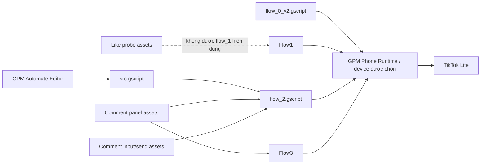

# Connections — Box_v2

## Luồng thực thi

| Thành phần | Kết nối/trách nhiệm |
| --- | --- |
| GPM Automate Editor | Sửa node/source và lưu project Phone |
| GPM Phone Runtime | Thực thi action Phone trên device đã chọn trong GPM |
| `src.gscript` | Main hiện gọi `flow_2`; không tự gọi `flow_0_v2` |
| `flow_0_v2.gscript` | Launcher TikTok Lite độc lập, hỗ trợ legacy và modern package, rồi chờ **For You** |
| `flow_1.gscript` | Feed gate, đọc kích thước, xem/vuốt, random Like |
| `flow_2.gscript` | Feed gate, đọc kích thước, xem/vuốt 3 video, nhập/gửi comment, xác minh và đóng panel |
| `flow_3.gscript` | Feed gate, đọc kích thước, xem/vuốt 3 video, đọc/scroll comment, đóng panel có retry |
| TikTok Lite | Ứng dụng đích; UI thực tế có thể thay đổi theo phiên bản/thiết bị |

## TikTok Lite launcher

| Biến thể | Component được thử | Cách xác nhận |
| --- | --- | --- |
| Legacy | `com.zhiliaoapp.musically.go/.mini.MainActivity` | `topResumedActivity` chứa package legacy |
| Modern | `com.tiktok.lite.go/com.zhiliaoapp.musically.go.mini.MainActivity` | `topResumedActivity` chứa package modern |

Flow thử legacy trước, rồi modern nếu legacy chưa foreground. Không lưu package cố định theo tất cả device: launcher/package cần canary khi có image hoặc version TikTok Lite mới.

## Asset hình ảnh

| File | Mục đích | Trạng thái trong flow chính |
| --- | --- | --- |
| `tiktok_like.img64` | Probe vị trí biểu tượng Like | Không dùng để quyết định Like |
| `tiktok_liked.img64` | Thử xác minh trạng thái Liked | Không dùng; kết quả có false positive/không ổn định |
| `tiktok_comment.img64` | Probe vị trí Comment | Không dùng trong `flow_1` |
| `tiktok_verifypanelcomment.img64` | Xác minh Comment panel mở/còn hiển thị | `flow_2` và `flow_3` dùng |
| `tiktok_closecomment.img64` | Tìm vị trí Close của Comment panel | `flow_2` và `flow_3` dùng |
| `tiktok_addcomment.img64` | Tìm ô nhập comment | `flow_2` dùng |
| `tiktok_sendcomment.img64` | Tìm nút Send | `flow_2` dùng |
| `tiktok_verifysentcomment.img64` | Xác minh ảnh trạng thái comment vừa gửi | `flow_2` dùng sau Send |

Asset Like vẫn chỉ phục vụ nghiên cứu do nền video động. Hai asset Comment là selector ảnh có phạm vi hẹp cho panel hiện tại; chúng không thay thế canary khi app/layout đổi.

## Ranh giới vận hành

- Không chứa thông tin tài khoản, cookie, mật khẩu, proxy hay cấu hình MikroTik trong project/tài liệu này.
- Mapping device, Android user và mạng được quản lý ngoài Box_v2. Một network IP hiển thị thành công không thay thế kiểm tra HTTPS/TikTok thực tế.
- Không chạy đồng thời GPM Phone và BoxPhone V3 trên cùng phone để tránh tranh chấp foreground/input.
- Sau khi chỉnh `.gscript` trực tiếp, phải reload Editor trước khi chạy; source/file và cây node đang hiển thị có thể chưa đồng bộ.
- Dấu `✓` xác nhận Runtime đã hoàn thành action, không mặc định xác nhận hiệu ứng phía TikTok. Với Like, `$likeResult` chỉ phản ánh nhánh thao tác đã gửi; với gửi comment, `$flow2Result` cần có `COMMENT_SEND_VERIFIED` để ghi nhận asset xác minh; kết quả đóng panel nằm ở `$commentPanelCloseResult`. Flow 3 giữ biến lịch sử `$flow2Result` cho trạng thái panel.

## Khi có device hoặc UI mới

1. Chạy `flow_0_v2` để xác nhận launcher và foreground.
2. Mở feed và kiểm tra XPath **For You**.
3. Kiểm tra output `wm size`, vùng vuốt, và bottom bar bằng một canary không Like/Comment trước.
4. Chỉ kiểm thử Like trên device/bố cục đã được phê duyệt; điểm `1333,1672` chưa tự thích nghi theo kích thước mới.
5. Với `flow_2`, kiểm thử riêng điểm Comment `1337,1897`, asset ô nhập/Send/trạng thái gửi và thao tác Close.
6. Với `flow_3`, kiểm thử riêng vùng scroll panel và hai tình huống Close (đóng ngay; lần đầu chỉ đóng bàn phím).
6. Cập nhật runbook cùng source nếu thay đổi selector, tỷ lệ, package, hoặc bằng chứng xác minh.
