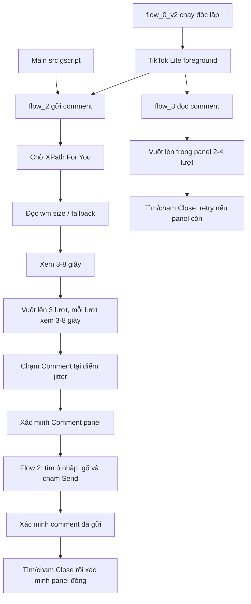

# Runbook — Box_v2 TikTok Lite

## Điều kiện và giới hạn

| Mục | Giá trị hiện tại |
| --- | --- |
| Project | `D:\gpm\Box_v2` |
| Loại project | GPM Automate Phone |
| Feed ổn định | `For You` — XPath `//node[@text="For You" and @class="android.widget.Button"]` |
| Thiết bị đã canary | Device 05, bố cục `1440 × 2960` |
| Main hiện tại | Gọi `flow_2` |
| `flow_1` | 5 lượt vuốt và cơ hội Like 2/9 |
| `flow_2` | 3 lượt vuốt video, sau đó gửi Comment và đóng panel |
| `flow_3` | 3 lượt vuốt video, sau đó đọc/scroll Comment panel |

Không chạy GPM Phone đồng thời với một workflow BoxPhone V3 khác trên cùng device. Việc chọn device/user/proxy nằm ngoài phạm vi của project này.



## `flow_0_v2`: mở TikTok Lite

Flow này không được Main gọi mặc định. Nó thử các launcher theo thứ tự sau:

1. Legacy: `com.zhiliaoapp.musically.go/.mini.MainActivity`.
2. Đọc `dumpsys activity activities`, xác nhận `topResumedActivity` có package legacy.
3. Nếu chưa foreground, thử modern: `com.tiktok.lite.go/com.zhiliaoapp.musically.go.mini.MainActivity`.
4. Xác nhận foreground package modern, chờ 1,5–2,5 giây, rồi chờ XPath **For You** tối đa 15 giây.

Không thêm `--user` vào lệnh launcher/package. Runtime từng trả `Bad user number` khi nhận Android user `10`; launcher không có `--user` đã mở thành công TikTok Lite trên Device 05. Việc thành công từ `am start` phải được đối chiếu bằng bước foreground, không chỉ dựa vào dấu `✓` của action.

## `flow_1`: xem, vuốt và Like xác suất

### 1. Xác nhận feed và kích thước màn hình

- `PhoneWaitElement` chờ **For You** tối đa 20 giây.
- `PhoneExecuteAdb` gọi `shell wm size`, lưu vào `$screenSizeRaw`.
- Hai node Regex lấy `$screenWidthRead` và `$screenHeightRead` từ dòng `Physical size: WIDTHxHEIGHT`.
- Nếu thiếu một trong hai giá trị, flow giữ fallback `$screenWidth = 1440`, `$screenHeight = 2960`.

Fallback là tương thích Device 05, không phải khẳng định mọi device có cùng kích thước. Luôn xem log kích thước khi canary một bố cục mới.

### 2. Vùng vuốt theo tỷ lệ

Mỗi giá trị unit được random rồi quy đổi bằng `dimension × unit / 20`.

| Điểm | Unit | Tỷ lệ màn hình | Mục đích |
| --- | ---: | ---: | --- |
| Start X | 8–12 | 40–60% chiều rộng | Tránh mép trái/phải |
| Start Y | 16–17 | 80–85% chiều cao | Bắt đầu thấp trên video |
| End X | 8–12 | 40–60% chiều rộng | Giữ đường vuốt tự nhiên |
| End Y | 8–9 | 40–45% chiều cao | Kết thúc vùng giữa trên |
| Duration | 450–700 ms | — | Nhịp vuốt |

Mỗi lượt:

1. Sinh unit và duration.
2. Tính `$scrollStartX/Y`, `$scrollEndX/Y`, rồi ghép thành `$scrollStartPos` và `$scrollEndPos`.
3. `PhoneScroll` với `SCROLL_TYPE=POINTS`, `DIRECTION=Up`.
4. Chờ/xem video mới ngẫu nhiên 3–8 giây.

Flow cũng chờ 3–8 giây trước lượt vuốt đầu tiên. Vòng lặp dùng `$swipeCount = 5`; cần đổi biến này khi muốn thay số lượt, không sửa rời từng node.

### 3. Quyết định Like

Sau lượt vuốt cuối:

1. `NumberRandom` ghi `$actionRoll` trong khoảng 1–9.
2. Điều kiện `$actionRoll = 1 || $actionRoll = 2` đi vào nhánh Like.
3. Nhánh Like sinh `$likeJitterX/Y` trong khoảng -8…8 và tính:

   ```text
   likeTapX = 1333 + likeJitterX
   likeTapY = 1672 + likeJitterY
   ```

4. `PhoneTouch` chạm `$likeTapPos`, sau đó ghi `LIKE_TAP_SENT_ROLL_<n>`.
5. Nhánh còn lại không chạm màn hình, ghi `LIKE_NOT_SELECTED_ROLL_<n>`.

Không đặt Delay 5 giây hay Image Search để xác minh Liked sau chạm: ảnh trái tim đỏ không cho kết quả đủ ổn định trên nền video thay đổi. Điều này cố ý; không diễn giải `LIKE_TAP_SENT` là Like đã được TikTok ghi nhận.

## `flow_2`: xem video, gửi comment và đóng panel

### 1. Feed, kích thước và 3 video mới

`flow_2` dùng cùng gate **For You**, `shell wm size` và fallback `1440 × 2960` như `flow_1`. Sau khi xem video hiện tại 3–8 giây, flow dùng `PhoneScroll` `SCROLL_TYPE=POINTS`, `DIRECTION=Up` để qua 3 video mới. Mỗi lượt dùng vùng tỷ lệ 40–60% chiều rộng, 80–85% chiều cao xuống 40–45% chiều cao, trong 450–700 ms, rồi chờ 3–8 giây.

### 2. Mở panel, nhập và gửi

- `$commentRoll` hiện là `1–2`, do đó luôn vào nhánh Comment.
- Flow chạm điểm cơ sở `1337,1897` với jitter `±15 px`, chờ **8–12 giây**, rồi xác minh `tiktok_verifypanelcomment.img64` ở ngưỡng `0.8`.
- Sau khi panel được xác minh, flow tìm `tiktok_addcomment.img64`, chạm vị trí tìm được, chờ 6–8 giây, lấy một dòng ngẫu nhiên từ `D:\docs\comments_warmup.telex.txt` và nhập bằng `PhoneTypeText`.
- Flow chờ 3 giây, tìm `tiktok_sendcomment.img64`, rồi chạm Send. Nếu không tìm được, ghi `COMMENT_SEND_BUTTON_NOT_FOUND`.
- Sau chạm Send, flow chờ 5–8 giây, xác minh `tiktok_verifysentcomment.img64`. Kết quả gửi là `COMMENT_SEND_VERIFIED` hoặc `COMMENT_SEND_TAPPED_NOT_VERIFIED`.

### 3. Đóng panel sau gửi

Khi Send đã được tìm/chạm, flow chờ 3 giây, tìm `tiktok_closecomment.img64`, chạm Close, chờ 3 giây và kiểm tra lại `tiktok_verifypanelcomment.img64`.

- `$commentPanelCloseResult = COMMENT_PANEL_CLOSED`: panel không còn thấy.
- `COMMENT_PANEL_STILL_OPEN`: panel vẫn còn thấy.
- `COMMENT_CLOSE_ICON_NOT_FOUND`: không tìm được nút Close.

`$flow2Result` giữ riêng kết quả gửi, còn `$commentPanelCloseResult` giữ kết quả đóng panel.

## `flow_3`: xem video, đọc comment và đóng panel

`flow_3` dùng cùng gate **For You**, `wm size`, ba lượt vuốt video, và điểm Comment `1337,1897 ±15 px` như `flow_2`. Đây là flow đọc, không nhập hay gửi text.

1. Sau chạm Comment, flow chờ 6–10 giây và xác minh panel bằng `tiktok_verifypanelcomment.img64`.
2. Khi panel đã mở, flow chọn 2–4 lượt và chỉ dùng `PhoneScroll` theo điểm với `DIRECTION=Up`:

   | Tham số | Khoảng |
   | --- | --- |
   | X | 360–1080 |
   | Điểm bắt đầu Y | 1850–2250 |
   | Điểm kết thúc Y | 1150–1500 |
   | Thời lượng | 350–550 ms |

3. Flow chờ 2 giây, tìm/chạm `tiktok_closecomment.img64`, rồi xác minh panel. Nếu panel còn thấy, flow tìm/chạm Close thêm một lần và xác minh lại sau 3 giây.

Nhánh retry xử lý tình huống bài không có comment, khi chạm Close đầu chỉ đóng bàn phím ảo. `flow_3` dùng các mã `COMMENT_PANEL_CLOSED`, `COMMENT_PANEL_CLOSED_AFTER_RETRY`, `COMMENT_PANEL_STILL_OPEN_AFTER_RETRY` và `COMMENT_CLOSE_RETRY_ICON_NOT_FOUND` trong biến lịch sử `$flow2Result`.

## Bằng chứng hiện có

| Hạng mục | Kết quả |
| --- | --- |
| Mở Lite legacy trên Device 05 | `topResumedActivity` xác nhận `com.zhiliaoapp.musically.go/.mini.MainActivity` foreground |
| XPath For You | Đã khớp trong các lần probe trên Device 05 |
| Vuốt tỷ lệ/ngẫu nhiên | Đã chạy trong probe; `PhoneScroll` chuyển video |
| Like fixed-point | Quan sát thực tế xác nhận thao tác Like tại vùng `1333,1672` trên Device 05 |
| `flow_0_v2`, `flow_1`, `flow_2`, `flow_3` hiện tại | Người vận hành xác nhận đã kiểm thử độc lập thành công ngày 16-10-2026 |
| `flow_2` gửi comment | Log kiểm thử có `COMMENT_SEND_VERIFIED` và `COMMENT_PANEL_CLOSED` |
| `flow_3` đọc comment | Đã kiểm thử độc lập thao tác scroll lên trong panel và đóng panel |
| Xác minh Liked bằng XPath/ảnh | Không đáng tin cậy, nên đã loại khỏi flow chính |

## Checklist mỗi lần canary

1. TikTok Lite đã mở, mạng hoạt động và đang ở feed **For You**.
2. Đảm bảo editor đã nạp source hiện tại.
3. Xác nhận log `$screenSizeRaw`; nếu thiếu, xác nhận thiết bị thực sự dùng fallback `1440 × 2960` hoặc dừng để đánh giá bố cục.
4. Xem các `$scrollStartPos`, `$scrollEndPos` không chạm khu vực điều hướng/bottom bar.
5. Ghi nhận `$actionRoll` và `$likeResult`. Lượt 3–9 không Like là hành vi đúng.
6. Với lượt 1–2, chỉ đánh giá bằng quan sát UI nếu cần; không lấy Image Search Liked làm bằng chứng pass/fail.

### Canary cho `flow_2`

1. Main đã nạp `src.gscript` hiện gọi `flow_2`; TikTok Lite đang ở **For You**.
2. Kiểm tra `$screenSizeRaw`, `$commentPos`, `$commentInputPos` và `$sendButtonPos`.
3. Chỉ tiếp tục nếu có `COMMENT_PANEL_OPEN`; sau gửi kiểm tra `$flow2Result` là `COMMENT_SEND_VERIFIED` hoặc `COMMENT_SEND_TAPPED_NOT_VERIFIED`.
4. Kiểm tra `$commentPanelCloseResult` là `COMMENT_PANEL_CLOSED`. Nếu panel còn thấy, lưu bằng chứng UI tối thiểu để cập nhật asset/toạ độ.

### Canary cho `flow_3`

1. Chạy `flow_3` riêng khi TikTok Lite ở **For You**.
2. Sau `COMMENT_PANEL_OPEN`, quan sát 2–4 lượt vuốt vẫn nằm trong danh sách comment.
3. Sau Close, kiểm tra `$flow2Result` là `COMMENT_PANEL_CLOSED` hoặc `COMMENT_PANEL_CLOSED_AFTER_RETRY`.

Nếu XPath **For You** timeout, dừng flow và khôi phục app/feed trước khi chạy lại. Không thêm click mù hoặc selector suy đoán vào flow này.
